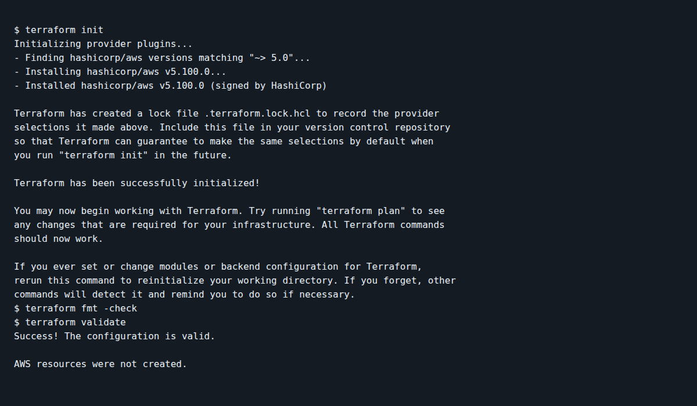

# Session 19 - AWS network with Terraform

Dhruv Bansal (24BCS10114)

This configuration defines the six pieces from the mini-project: VPC `10.20.0.0/16`, public subnet `10.20.1.0/24`, internet gateway, public route table, its subnet association, and a web security group. The route to `0.0.0.0/0` makes the subnet public. The security group allows HTTP only; I did not open SSH to the internet.

Copy `terraform.tfvars.example` to `terraform.tfvars`, set an AWS region and unique project name, then run `terraform init`, `terraform fmt -check`, `terraform validate`, and `terraform plan`. Applying this plan creates AWS resources and needs valid credentials. If you choose to apply it, check `terraform output` and `terraform state list`, then run `terraform destroy` to remove the lab resources. No EC2 instance is included, so this creates a network but does not host a website.

I checked the configuration with `terraform init`, `fmt -check`, and `validate` on a GitHub Actions runner ([run](https://github.com/dhruvb2028/devops-heros/actions/runs/38804432107/job/116661500361)). No AWS resources were created and no account credentials were used.

