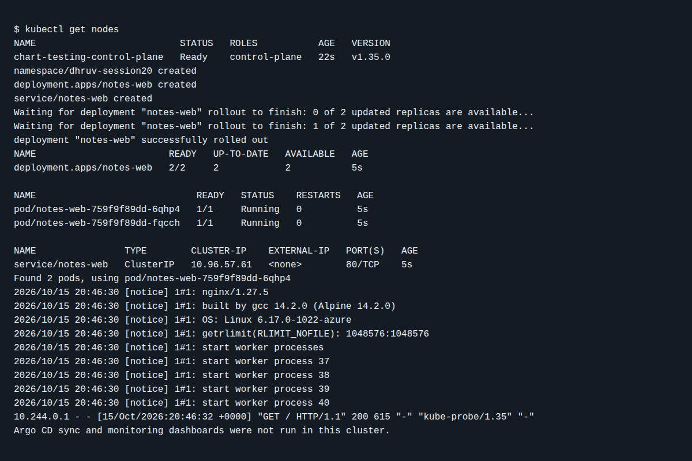

# Session 20 - Observability and GitOps

Dhruv Bansal (24BCS10114)

For the mini-project, the `app/` folder contains a namespace, a two-replica Nginx Deployment and a Service. `argocd-application.yaml` is outside `app/`: Argo CD watches the workload files, not its own Application definition. The Application points to my repository's `main` branch and enables automatic sync, pruning and self-healing.

I would check the deployment with `kubectl get deployment,pods,service -n dhruv-session20` and inspect its logs with `kubectl logs deployment/notes-web -n dhruv-session20`. With Argo CD running, `kubectl apply -f argocd-application.yaml` would register the app. Changing `replicas` in Git from 2 to 3 should cause Argo CD to reconcile the cluster; changing it directly in the cluster should be corrected by self-healing.

The observability distinction from this session: metrics are measurements such as request count or CPU use; logs record individual events; traces follow a request between services. Prometheus collects metrics and Grafana displays them. The pod logs above are useful for debugging, but this Nginx demo does not yet export application-specific Prometheus metrics or traces.

These files are committed in the repository. I ran the Deployment and Service in a temporary kind cluster; both Pods reached Ready ([run](https://github.com/dhruvb2028/devops-heros/actions/runs/38804541359/job/116661870702)). I did not install Argo CD or monitoring dashboards, so this does not show sync, self-healing, metrics, or traces.

