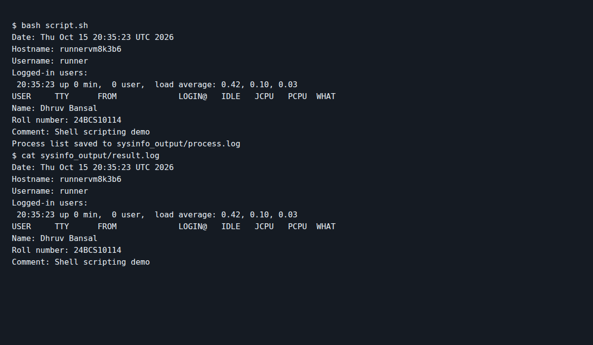

# Session 3 - Shell Scripting

Dhruv Bansal - 24BCS10114

I wrote `script.sh` to take my name, roll number, and a comment as input. It also collects the current date, hostname, logged-in user, active users, and process list.

```bash
bash script.sh
```

Example output:

```text
Enter your name: Dhruv Bansal
Enter your roll number: 24BCS10114
Enter your comment: Shell scripting task
Date: <current date and time>
Hostname: <machine hostname>
Username: <current user>
Logged-in users:
Name: Dhruv Bansal
Roll number: 24BCS10114
Comment: Shell scripting task
Process list saved to sysinfo_output/process.log
```

The script creates the `sysinfo_output` directory automatically. The main details are saved in `result.log`, while the output of `ps` is saved separately in `process.log`.

I ran the script on a Linux GitHub Actions runner and captured its output and saved result file ([run](https://github.com/dhruvb2028/devops-heros/actions/runs/38803157774/job/116657129714)).


