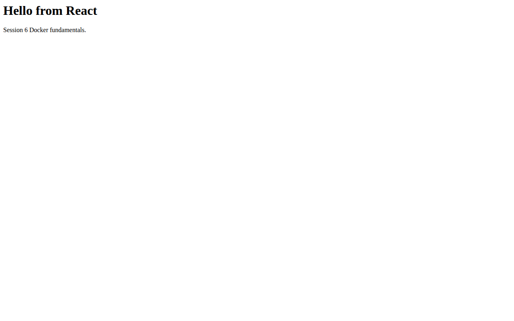
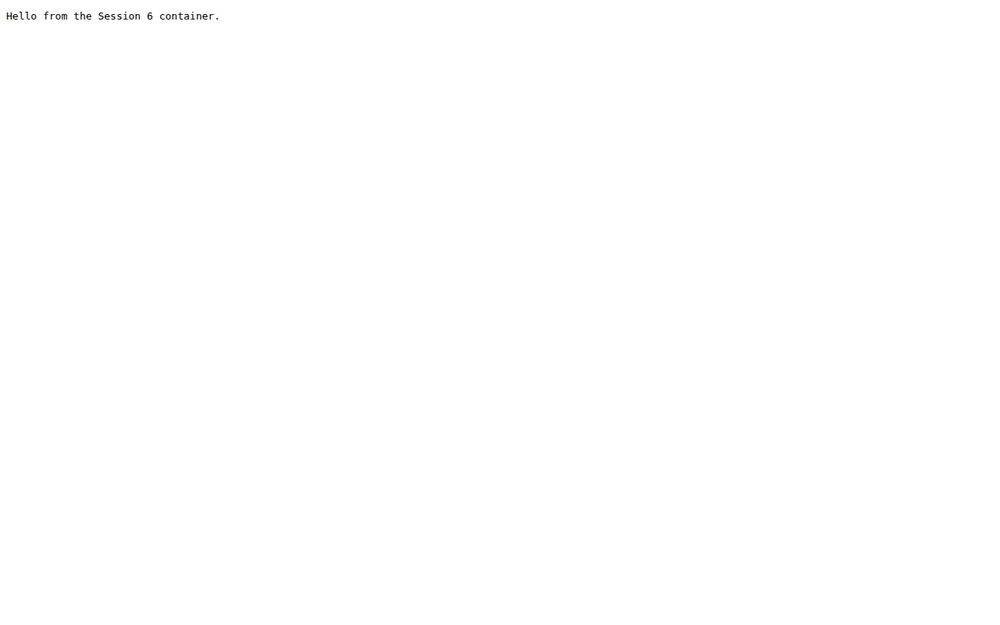

# Session 6 - Docker Fundamentals

Dhruv Bansal - 24BCS10114

I created small Docker examples for NGINX, Apache, Python, Node.js, Java, and React. Each folder has its own source file and Dockerfile, so the images can be built separately.

| Folder | Container port |
| --- | --- |
| `hello-nginx` | 80 |
| `hello-apache` | 80 |
| `hello-python` | 8080 |
| `hello-node` | 3000 |
| `hello-java` | 8083 |
| `hello-react` | 80 |

For example, I built and ran the Python image with:

```bash
docker build -t session6-python ./hello-python
docker run --rm --name session6-python -p 8080:8080 session6-python
curl http://localhost:8080
```

The same process works for the other folders after changing the image name and port. I used `docker ps`, `docker logs <container>`, `docker images`, and `docker inspect <container>` to check the result. The `--rm` option removes the container after it stops, but the image remains available for another run.

## Screenshots

I built and ran the Python and React images on a GitHub Actions runner. The [Session 6 job](https://github.com/dhruvb2028/devops-heros/actions/runs/38801696689/job/116652084969) has the Docker build, `docker ps`, and HTTP checks. These are captures from the running containers, not a local Docker Desktop session.




